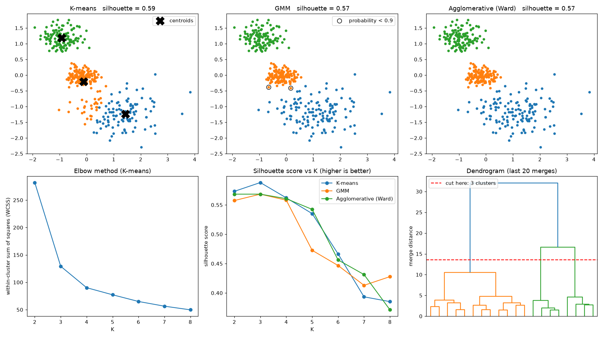

# Clustering demo: K-means, GMM and agglomerative clustering

Groups 400 unlabelled points with three clustering methods and evaluates each result with the silhouette score (Lecture 9).

* **K-means** with k-means++ initialisation
* **Gaussian mixture model (GMM)**, a soft clustering: every point gets a probability for each cluster
* **Agglomerative clustering** with Ward linkage, plus its dendrogram
* **Choosing K** with the elbow method (WCSS) and the silhouette score for K = 2 to 8

## Run

```
pip install -r requirements.txt
```

(Anaconda already includes these packages.)

* **Jupyter:** open `clustering_demo.ipynb` and run the cell.
* **Terminal:** `python clustering_demo.py`. The figure opens in a window.

It takes a few seconds.

## Expected results

```
K-means               silhouette = 0.588
GMM                   silhouette = 0.568
Agglomerative (Ward)  silhouette = 0.568
```



How to read the figure:

* The data has 3 groups with different spreads: a tight one at the top left (green), a small one in the middle (orange) and a wide one at the bottom right (blue).
* GMM and agglomerative clustering find these 3 groups. K-means gives the upper-left part of the wide blue group to the orange cluster: it assigns every point to its nearest centre and ignores how spread out a cluster is.
* In the GMM plot, the circled points are the ones GMM is unsure about (probability below 0.9 for their cluster).
* The elbow plot and the silhouette curve both point to K = 3. Cutting the dendrogram at the red line also gives 3 clusters.
* K-means gets the highest silhouette score even though it splits a group wrongly. The silhouette score rewards round, compact clusters, so a higher score does not always mean the clusters match the real groups.

## Things to try

1. Change `K = 3` to `K = 2` or `K = 4`. What happens to the three silhouette scores?
2. Make the groups overlap more: change `cluster_std=[0.8, 1.6, 0.6]` to `cluster_std=[1.2, 2.0, 1.0]`. Do the three methods still agree?
3. Try the other linkages from the lecture: change `LINKAGE = "ward"` to `"single"`, `"average"` or `"complete"`. The agglomerative plot and the dendrogram both change.
4. Replace the data with two half-moons and set `K = 2`:
   ```python
   from sklearn.datasets import make_moons
   X, _ = make_moons(n_samples=400, noise=0.05, random_state=0)
   ```
   Which method separates the two moons? Try `LINKAGE = "single"` as well. Does the silhouette score pick the method that separates them?
